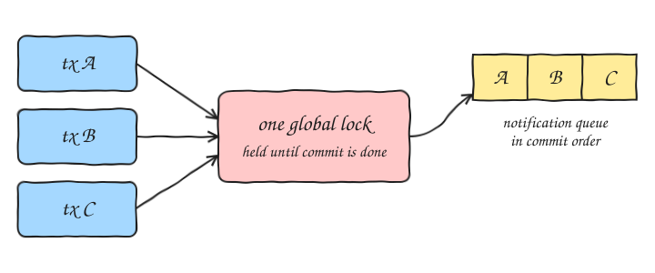
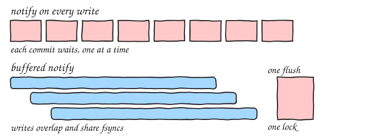
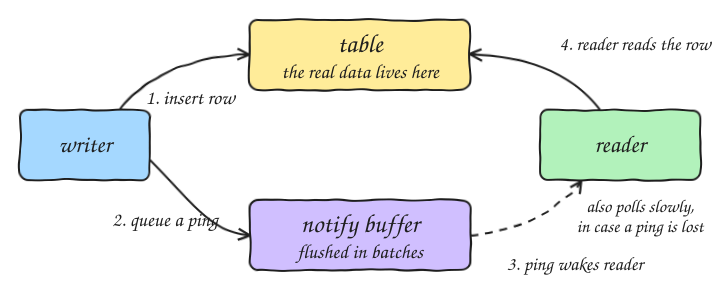

# The one lock hiding behind Postgres LISTEN/NOTIFY

Research notes, November 2026. Also published on [my site](https://prasadf18.github.io/blog/postgres-notify-global-lock/).

I keep seeing two opposite claims about Postgres LISTEN/NOTIFY. One camp says it does not scale at all. The other says it scales fine if you use it right. Both sides have a blog post with numbers, so I read them side by side, read the docs, and tried to work out who is right. This is a research post. I did not run my own benchmarks here, so every number below comes from the sources I link at the end.

## What it is

NOTIFY lets one database session send a small message on a named channel. Any session that ran LISTEN on that channel gets the message. It is a cheap way to say "something changed, go look" without polling.

Two details from the docs matter later. A notification is only delivered when the sending transaction commits. And the payload has to be shorter than 8000 bytes, so the docs suggest sending a row key and reading the real data from a table.

## Where it goes wrong

A team at Recall.ai writes data to Postgres from tens of thousands of writers at once. In March 2025 their database stalled three times. The odd part was that CPU, disk and network all dropped while the load went up. Nothing was busy, everything was waiting.

They turned on `log_lock_waits` and found a huge queue of sessions all waiting for the same heavyweight lock during COMMIT. The lock was taken by transactions that had called NOTIFY. It is a database wide lock, so only one of those commits can go through at a time.

*Every transaction that sent a NOTIFY has to pass through the same door to commit.*

## Why the lock exists

This is the part I found most interesting, because the lock is there for a good reason.

Postgres promises that notifications arrive in the same order as the transactions that sent them committed. To keep that promise it keeps one global queue of outgoing notifications. A transaction has to add its notifications to that queue as part of committing.

The catch is that Postgres only knows the commit order once the commits are done, and a commit can take a variable amount of time. So the order has to be fixed before the commit finishes. The simple answer is a global lock that makes these commits go one after another. The DBOS team describes the lock as held until the commit is fully flushed to disk with fsync.

That also explains the missing CPU. Normally Postgres groups several commits into a single fsync, which is called group commit. With the lock in place that grouping cannot happen for these transactions. Each one pays for its own flush, in line, and the machine sits idle between them.

## The fix that DBOS used

The DBOS team hit the same wall while building streams on Postgres, where every chunk of an LLM response is a row and a trigger sent a NOTIFY for each write. They could not get past about 2.9 thousand writes a second, even on a big machine.

Their observation is that in many uses the notification is just a nudge. The real data lives in a table. So the nudge does not need to be perfectly ordered or perfectly durable. They buffer notifications in memory and send them in one batch, so the lock is taken once per flush and not once per write.

*Red is time spent holding the global lock. Blue is normal writes.*

There is one new problem with this. If the process crashes while notifications sit in the buffer, those nudges are lost. Their answer is for readers to also poll the table every so often, slowly, as a safety net. Since the table is the source of truth, a late nudge costs a little latency and nothing else.

*The ping only says "look". The table has the answer.*

With this change they report up to 60 thousand stream writes a second, about 20 times more than before, with latency in the range of 15 to 100 milliseconds. At that point the Postgres CPU is fully used, which is what you would hope to see. The database is busy and no longer waiting.

## Is it fixed in Postgres now?

I could not get a clean answer, and I think that is the honest finding.

Recall.ai added an update to the top of their post saying a commit in Postgres core eliminated the bottleneck. DBOS wrote later that a patch going into Postgres 19 does not remove the global lock. They say it speeds up a narrower case, where there are many channels and each listener waits on only one of them.

Both can be true if they are talking about different changes. I did not read the Postgres source to settle it, so I would not rely on either claim. If you plan to use NOTIFY on a busy write path, test it on your own version with many concurrent writers.

## What I take from this

NOTIFY is fine for small things, like telling a few workers that there is a new job. The trouble starts when every write on a hot table fires one. If you do that, you are choosing to make those commits wait for each other.

If you can treat the ping as a hint and keep the real state in a table, batching the pings and polling slowly as a backup looks like a safe pattern. Also, if a database looks slow while CPU and disk are quiet, check for lock waits before you buy a bigger machine. `log_lock_waits` was what cracked the case for Recall.ai.

I learned most from this by reading why the lock exists. The ordering promise sounds like a small feature, and it ends up shaping how the whole commit path behaves.

## Sources

- Recall.ai, [Postgres LISTEN/NOTIFY does not scale](https://www.recall.ai/blog/postgres-listen-notify-does-not-scale)
- DBOS, [Postgres LISTEN/NOTIFY Can Actually Scale](https://dbos.dev/blog/postgres-listen-notify-scalability)
- PostgreSQL docs, [NOTIFY](https://www.postgresql.org/docs/current/sql-notify.html)
